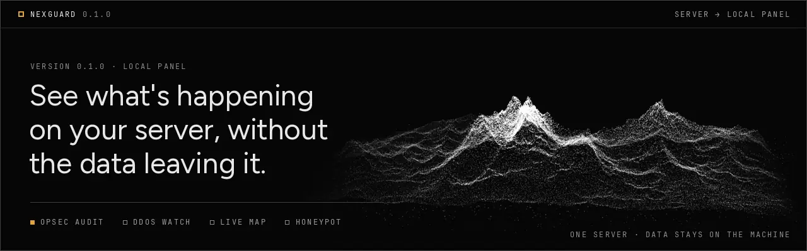

<p align="center">
  
</p>

<p align="center">
  <b>A fully local panel that shows your server's security state on one screen.</b><br>
  <a href="https://nexguard.duckdns.org">nexguard.duckdns.org</a>
  Data never leaves the machine. The panel suggests fixes; it never changes anything on its own.
</p>

---

## What it does

When you suspect an attack and open the panel, within seconds you see:

- whether the server is safe or under attack (state is shown with both color and text)
- which countries and networks connections are coming from
- which weaknesses exist in SSH and system settings, and what to do about them

## Modules

| Module | What it shows |
| --- | --- |
| **Overview** | Status band, recent events, summary counts |
| **Audit** | OPSEC checks: SSH settings, empty passwords, passwordless sudo, SUID files. A suggested fix for every finding, nothing applied |
| **DDoS watch** | Connection counts and alerts when a threshold is crossed (Telegram, webhook) |
| **Live map** | TCP connection sources on a world map. Flat 2D map or a rotatable 3D globe; the globe shows country borders or satellite imagery (gray or color), zoom up to 8× with the wheel or +/− |
| **Geography** | Country, ASN and Tor/VPN flags for IPs. Local lookups with DB-IP Lite |
| **Honeypot** | Attempts against the SSH honeypot: tried passwords, commands, source IPs. Plus a multi-port TCP trap (records who connects on ports like Telnet, RDP and VNC and their first bytes; it does not block) |
| **IP details** | A drawer that opens when you click any IP in a table or a country on the globe: country/ASN, live connections, SSH attempts, honeypot records, events. Block, unblock and allowlist actions need a two-step confirmation |
| **Settings** | Password change, 2FA (TOTP) setup, notification channels |

## Privacy and security

- **Runs locally.** The panel listens on `127.0.0.1:8787` by default. Remote access goes through an SSH tunnel.
- **No root needed.** System information is read from `/proc`, systemd and nftables.
- **No data leaves the machine.** IP lookups run against a local database.
- **Login:** username and password (argon2 hash), optional TOTP, CSRF protection, rate-limited login attempts.
- **Suggests, never applies.** The panel shows the fix command; it does not run it.

## Limits

Honesty is part of the product:

- The map only shows TCP connections. The source of UDP or ICMP floods is not visible.
- Volumetric attacks cannot be stopped on the server itself. The panel offers detection, alerts and hardening advice.
- The TCP trap only records; its ports must be opened in the firewall to be reachable from outside. Ports 22, 53, 80, 443 and the panel port cannot be traps.
- The 3D globe needs WebGL2; browsers without it get the 2D map.

## Installation

Requires Python 3 (tested with 3.13).

```bash
git clone https://github.com/m3lonxd/nexguard.git
cd nexguard
python3 -m venv .venv
.venv/bin/pip install -r requirements.txt

# First admin account (password of at least 12 characters)
.venv/bin/python -m nexguard create-admin <username>

# Start the panel
.venv/bin/python -m nexguard run
```

Open `http://127.0.0.1:8787` in your browser.

If you installed it on a remote server, open the panel through an SSH tunnel:

```bash
ssh -N -L 8788:127.0.0.1:8787 user@server
```

Then go to `http://localhost:8788`.

### Optional components (root)

If the panel is installed under `/opt/nexguard` as `nexguard.service`:

```bash
sudo sh deploy/kur.sh
```

This installs the packet sensor (`nexguard-sensor`), the block helper (`nexguard-engel`) and the TCP trap (`nexguard-tcptuzak`). The TCP trap listens on no port until you enable it in the panel, and runs with only the `CAP_NET_BIND_SERVICE` capability. Open the trap ports you enable in the firewall too (e.g. `ufw allow 2323/tcp`).

## Configuration

| Environment variable | Default | Description |
| --- | --- | --- |
| `NEXGUARD_HOST` | `127.0.0.1` | Address to listen on. Don't change it to expose the panel; use an SSH tunnel |
| `NEXGUARD_PORT` | `8787` | Panel port |
| `NEXGUARD_DATA` | `~/.local/share/nexguard` | Database, session key and geography data |
| `NEXGUARD_COWRIE_LOG` | empty | Path to the Cowrie JSON log; the honeypot module reads it |

## Tests

```bash
.venv/bin/python -m pytest -q
```

## Layout

```
nexguard/
  app.py          FastAPI app, routes, login
  security.py     argon2, CSRF, TOTP, login rate limiter
  checks.py       OPSEC checks
  geoip.py        IP → country/ASN, Tor list
  modules/        Overview, Audit, DDoS, Map, Geography, Honeypot, Settings
  templates/      Jinja2 templates
  ipdetail.py     IP detail drawer data and manual block / allowlist actions
  tcptuzak.py     multi-port TCP trap: service and panel side
  static/         single CSS file, map and 3D globe scripts, detail drawer, satellite texture (NASA Blue Marble, public domain)
tests/            pytest tests
```
