<p align="center">
  
</p>

<p align="center">
  <b>Sunucunun güvenlik durumunu tek ekranda gösteren, tamamen yerel çalışan panel.</b><br>
  <a href="https://nexguard.duckdns.org">nexguard.duckdns.org</a>
  Veri makineden çıkmaz. Panel öneri sunar, hiçbir şeyi kendi kendine değiştirmez.
</p>

---

## Ne işe yarar

Bir saldırı şüphesinde sunucuya bakan kişi, panele girdiğinde saniyeler içinde şunları görür:

- sunucu güvenli mi, yoksa saldırı altında mı (durum renk ve metinle ayrı gösterilir)
- hangi ülkelerden, hangi ağlardan bağlantı geliyor
- SSH ve sistem ayarlarında hangi açıklar var, ne yapılmalı

## Modüller

| Modül | Ne gösterir |
| --- | --- |
| **Genel Bakış** | Durum bandı, son olaylar, özet sayılar |
| **Denetim** | OPSEC kontrolleri: SSH ayarları, boş parolalar, parolasız sudo, SUID dosyalar. Her bulgu için düzeltme önerisi, uygulama yok |
| **DDoS izleme** | Bağlantı sayıları ve eşik aşımında bildirim (Telegram, webhook) |
| **Canlı harita** | TCP bağlantı kaynaklarının dünya haritasında gösterimi |
| **Coğrafya** | IP'lerin ülke, ASN ve Tor/VPN işaretleri. DB-IP Lite ile yerel sorgu |
| **Tuzak** | SSH tuzağındaki denemeler: denenen parolalar, komutlar, kaynak IP'ler |
| **Ayarlar** | Parola değişimi, 2FA (TOTP) kurulumu, bildirim kanalları |

## Gizlilik ve güvenlik

- **Yerel çalışır.** Panel varsayılan olarak `127.0.0.1:8787` üzerinde dinler. Uzaktan erişim SSH tüneliyle yapılır.
- **Root gerektirmez.** Sistem bilgisi `/proc`, systemd ve nftables üzerinden okunur.
- **Veri dışarı çıkmaz.** IP sorguları yerel veritabanında yapılır.
- **Giriş:** kullanıcı adı ve parola (argon2 hash), isteğe bağlı TOTP, CSRF koruması, giriş denemelerine sınır.
- **Öneri, uygulama yok.** Panel düzeltme komutu gösterir; çalıştırmaz.

## Sınırlar

Dürüstlük ürünün parçası:

- Harita yalnızca TCP bağlantılarını gösterir. Hat dolduran UDP veya ICMP saldırılarının kaynağı görünmez.
- Hacimli (volumetrik) saldırılar sunucuda durdurulamaz. Panel tespit, bildirim ve sertleştirme önerisi sunar.

## Kurulum

Python 3 gerekir (proje 3.13 ile test edildi).

```bash
git clone https://github.com/m3lonxd/nexguard.git
cd nexguard
python3 -m venv .venv
.venv/bin/pip install -r requirements.txt

# İlk yönetici hesabı (en az 12 karakter parola)
.venv/bin/python -m nexguard create-admin <kullanici-adi>

# Paneli başlat
.venv/bin/python -m nexguard run
```

Tarayıcıda `http://127.0.0.1:8787` adresini aç.

Uzak sunucuya kurduysan paneli SSH tüneliyle aç:

```bash
ssh -N -L 8788:127.0.0.1:8787 kullanici@sunucu
```

Sonra `http://localhost:8788`.

## Yapılandırma

| Ortam değişkeni | Varsayılan | Açıklama |
| --- | --- | --- |
| `NEXGUARD_HOST` | `127.0.0.1` | Dinlenecek adres. Dışarı açmak için değiştirme, SSH tüneli kullan |
| `NEXGUARD_PORT` | `8787` | Panel portu |
| `NEXGUARD_DATA` | `~/.local/share/nexguard` | Veritabanı, oturum anahtarı ve coğrafya verisi |
| `NEXGUARD_COWRIE_LOG` | boş | Cowrie JSON günlüğü yolu; tuzak modülü bunu okur |

## Testler

```bash
.venv/bin/python -m pytest -q
```

## Yapı

```
nexguard/
  app.py          FastAPI uygulaması, rotalar, giriş
  security.py     argon2, CSRF, TOTP, giriş sınırlayıcı
  checks.py       OPSEC denetimleri
  geoip.py        IP → ülke/ASN, Tor listesi
  modules/        Genel Bakış, Denetim, DDoS, Harita, Coğrafya, Tuzak, Ayarlar
  templates/      Jinja2 şablonları
  static/         tek CSS dosyası, harita betiği, ikon
tests/            pytest testleri
```
